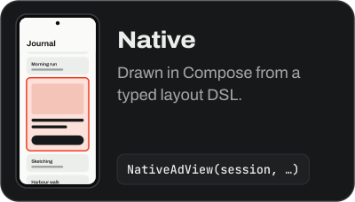
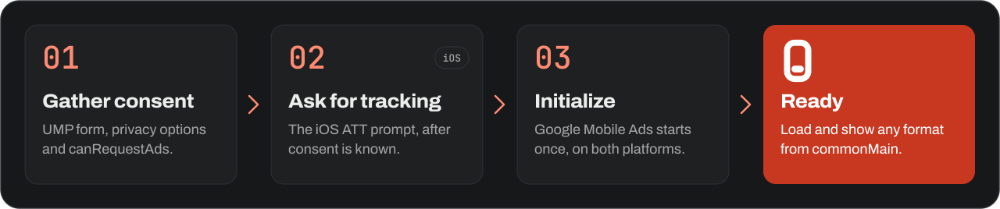

<picture>
  <source media="(prefers-color-scheme: dark)" srcset=".github/readme/hero-dark.svg">
  
</picture>

<h1 align="center">AdMob CMP — Compose Multiplatform AdMob SDK for Android and iOS</h1>

<div align="center">

[](https://central.sonatype.com/artifact/dev.avinya.ads/admob-cmp)
[](#compatibility)
[](#compatibility)
[](#compatibility)
[](LICENSE)
<br>
[](https://ads.avinya.dev)
[](https://ads.avinya.dev/reference/api/)
[](https://github.com/Meet-Miyani/admob-compose-multiplatform/stargazers)
[](https://github.com/Meet-Miyani/admob-compose-multiplatform/commits/master)
[](https://github.com/Meet-Miyani/admob-compose-multiplatform/discussions)
[](#contributing)

**[Documentation](https://ads.avinya.dev)** &nbsp;·&nbsp; **[Install](#install)** &nbsp;·&nbsp; **[Quickstart](#30-second-quickstart)** &nbsp;·&nbsp; **[Ad formats](#ad-formats)** &nbsp;·&nbsp; **[Compatibility](#compatibility)** &nbsp;·&nbsp; **[Contributing](#contributing)** &nbsp;·&nbsp; **[Sponsor](#sponsor)**

</div>

**AdMob CMP** is an open-source **Kotlin Multiplatform AdMob SDK** for **Compose Multiplatform** apps. Monetize Android and iOS from one `commonMain` API: **banner, interstitial, rewarded, rewarded interstitial, app-open and native ads**, with Google UMP consent for GDPR, App Tracking Transparency, mediation and paid events built in.

It wraps Google Mobile Ads Next-Gen on Android and Google Mobile Ads on iOS, so familiar AdMob concepts such as `AdValue`, `ResponseInfo`, adaptive banner sizes and UMP consent states carry over. You get suspend functions, `StateFlow` state and a sealed `AdEvent` stream. Coming from a hand-rolled `expect class AdManager`? Follow the [migration guide](https://ads.avinya.dev/start/migrate-from-expect-actual/).

> [!NOTE]
> **CMP means Compose Multiplatform** here, not Consent Management Platform, although UMP consent is built in. The library is **AdMob CMP**, the repository is **`admob-compose-multiplatform`**, and the Maven coordinate is, and will stay, **`dev.avinya.ads:admob-cmp`**.

## Ad formats

All six formats, on both platforms, from one API. Select a format to open its guide.

<p align="center">
  <a href="https://ads.avinya.dev/formats/banner/"></a>
  <a href="https://ads.avinya.dev/formats/interstitial/"></a>
  <a href="https://ads.avinya.dev/formats/rewarded/"></a>
  <a href="https://ads.avinya.dev/formats/rewarded/"></a>
  <a href="https://ads.avinya.dev/formats/app-open/"></a>
  <a href="https://ads.avinya.dev/formats/native/"></a>
</p>

<details>
<summary><strong>API map</strong>: controllers, composables and Google test ad units for every format</summary>
<br>

| Format | `AdFormat` | Controller (from `AdManager`) | Composable | Test ad units |
|---|---|---|---|---|
| Banner (incl. collapsible) | `AdFormat.Banner` | `banner(placement)` | `BannerAdView(placement)` | `TestAdIds.ANDROID_BANNER` / `IOS_BANNER` |
| Interstitial | `AdFormat.Interstitial` | `interstitial(placement)` | — | `ANDROID_INTERSTITIAL` / `IOS_INTERSTITIAL` |
| Rewarded | `AdFormat.Rewarded` | `rewarded(placement)` | — | `ANDROID_REWARDED` / `IOS_REWARDED` |
| Rewarded interstitial | `AdFormat.RewardedInterstitial` | `rewardedInterstitial(placement)` | — | `ANDROID_REWARDED_INTERSTITIAL` / `IOS_REWARDED_INTERSTITIAL` |
| App-open | `AdFormat.AppOpen` | `appOpen(placement)` + `AppOpenAdCoordinator` | — | `ANDROID_APP_OPEN` / `IOS_APP_OPEN` |
| Native | `AdFormat.Native` | `nativeAds.session(key, policy)` | `NativeAdView(session, slotKey, placement, layout)` | `ANDROID_NATIVE` / `IOS_NATIVE` |

</details>

## Install

**1. Add the dependency** to `commonMain`:

```kotlin
implementation("dev.avinya.ads:admob-cmp:2.8.0")
```

**2. Configure each platform.** Google's SDKs need an app ID on both, and iOS also needs two Swift packages.

<details>
<summary><strong>Android</strong>: add the app ID to the manifest</summary>
<br>

Put this inside `<application>` in the runnable app module, not in a shared library module:

```xml
<meta-data
    android:name="com.google.android.gms.ads.APPLICATION_ID"
    android:value="ca-app-pub-3940256099942544~3347511713" /> <!-- Google's sample ID: replace it -->
```

Full guide: [Android setup](https://ads.avinya.dev/start/android-setup/).

</details>

<details>
<summary><strong>iOS</strong>: add two Swift packages and the Info.plist keys</summary>
<br>

In Xcode, choose **File → Add Package Dependencies** and add both, with the rule **Up to Next Major**:

| Package | Product | Version |
|---|---|---|
| `https://github.com/googleads/swift-package-manager-google-mobile-ads.git` | `GoogleMobileAds` | 13.x |
| `https://github.com/googleads/swift-package-manager-google-user-messaging-platform.git` | `GoogleUserMessagingPlatform` | 3.x |

With a static Kotlin framework, add `-framework JavaScriptCore` to **Other Linker Flags**. Then add these keys to `Info.plist`:

```xml
<key>GADApplicationIdentifier</key>
<string>ca-app-pub-3940256099942544~1458002511</string> <!-- Google's sample ID: replace it -->
<key>NSUserTrackingUsageDescription</key>
<string>This identifier will be used to deliver personalised ads to you.</string>
<key>SKAdNetworkItems</key>
<array><!-- The current list of identifiers from Google AdMob --></array>
```

Full guide: [iOS setup](https://ads.avinya.dev/start/ios-setup/).

</details>

<details>
<summary><strong>Kotlin/Native tests</strong>: apply the Gradle plugin so <code>iosSimulatorArm64Test</code> links</summary>
<br>

A Kotlin/Native test executable has no Xcode to resolve the Swift packages for it, so the link fails with `Undefined symbols … _OBJC_CLASS_$_GAD*`. The plugin links Google Mobile Ads and UMP into those test executables:

```kotlin
plugins {
    id("dev.avinya.ads.admob-cmp") version "2.8.0"
}
```

</details>

**3. Verify the iOS integration** with `./gradlew :admob-cmp-core:doctorIos`. Stuck? Check [Troubleshooting](https://ads.avinya.dev/reference/troubleshooting/).

## 30-second quickstart

This runs against Google's official sample ad units, so it is safe to paste as-is.

```kotlin
@Composable
fun App() {
    val adManager = rememberAdManager()

    LaunchedEffect(Unit) {
        adManager.gatherConsentAndInitialize(
            AdConfig(
                androidAppId = TestAdIds.ANDROID_APP_ID,
                iosAppId = TestAdIds.IOS_APP_ID,
                testMode = true
            )
        )
    }

    val placement = remember {
        AdPlacement(
            id = "main_interstitial",
            format = AdFormat.Interstitial,
            androidAdUnitId = TestAdIds.ANDROID_INTERSTITIAL,
            iosAdUnitId = TestAdIds.IOS_INTERSTITIAL,
            strictTestMode = true
        )
    }
    val interstitial = remember(adManager) { adManager.interstitial(placement) }
    val scope = rememberCoroutineScope()

    Button(onClick = {
        scope.launch {
            interstitial.load()
            interstitial.show()
        }
    }) { Text("Show ad") }
}
```

<details>
<summary><strong>Banner ads</strong>: one composable, adaptive by default</summary>
<br>

The composable measures its own container and supplies the width, so adaptive sizing is correct even in iPad split view and Slide Over:

```kotlin
BannerAdView(
    placement = AdPlacement(
        id = "home_banner",
        format = AdFormat.Banner,
        androidAdUnitId = TestAdIds.ANDROID_BANNER,
        iosAdUnitId = TestAdIds.IOS_BANNER
    ),
    modifier = Modifier.fillMaxWidth()
)
```

</details>

<details>
<summary><strong>Native ads</strong>: a declarative layout DSL and bounded feed sessions</summary>
<br>

A feed reuses one placement id, keeps stable model-owned slot keys, and lets the session own native platform objects:

```kotlin
val nativePlacement = remember {
    AdPlacement(
        id = "feed_native",
        format = AdFormat.Native,
        androidAdUnitId = TestAdIds.ANDROID_NATIVE,
        iosAdUnitId = TestAdIds.IOS_NATIVE,
    )
}

val layout = remember {
    adLayout {
        column(modifier = AdModifier.fillMaxWidth()) {
            media(modifier = AdModifier.fillMaxWidth().aspectRatio(16f / 9f))
            headline(maxLines = 2)
            body(maxLines = 3)
            row(spacing = 8.dp) { icon(modifier = AdModifier.size(24.dp)); advertiser(); adBadge() }
            callToAction(modifier = AdModifier.fillMaxWidth())
        }
    }
}

val session = rememberNativeAdFeedSession(
    sessionKey = "feed",
    listState = listState,
    itemCount = feed.size,
    slotAt = { index -> (feed[index] as? FeedItem.NativeSlot)?.let { NativeAdSlot(it.key, nativePlacement) } },
)
NativeAdView(session = session, slotKey = "after-article-3", placement = nativePlacement, layout = layout)
```

> **Warning:** Use a static, finite placement id and stable model-owned slot keys. Never generate either from a row index. The default active session retains three records; the process-wide governor bounds loaded plus reserved ads at soft 4 / hard 6. A temporary tab exit deactivates the session and retains one anchor; permanently discarded destinations close it. Per-placement native TTL remains one hour by default.

</details>

## Consent, then ATT, then ads

<a href="https://ads.avinya.dev/privacy/consent/"></a>

`gatherConsentAndInitialize` runs UMP consent and then the one-time SDK initialization. It does not request App Tracking Transparency on iOS: for that, use the consent → ATT → initialize order in the [ATT guide](https://ads.avinya.dev/privacy/app-tracking-transparency/). Gate ad-dependent UI on `adManager.status.collectAsState()` reaching `AdManagerStatus.Ready`.

## Why AdMob CMP

<table>
<tr>
<td width="50%" valign="top"><strong>All six formats, both platforms</strong><br>Native and app-open ads included, with a layout DSL and bounded, viewport-aware sessions.</td>
<td width="50%" valign="top"><strong>Consent is part of initialization</strong><br>UMP modes, the privacy options form and <code>canRequestAds</code> are first-class, and the iOS consent → ATT → initialize order is built in.</td>
</tr>
<tr>
<td valign="top"><strong>The iOS test link works</strong><br>The Gradle plugin links Google Mobile Ads and UMP into Kotlin/Native test executables, so <code>iosSimulatorArm64Test</code> can pass.</td>
<td valign="top"><strong>Revenue and mediation are exposed</strong><br>Paid events carry <code>AdValue</code> and <code>ResponseInfo</code>, and mediation adapters get initialization hooks.</td>
</tr>
<tr>
<td valign="top"><strong>Test safety fails closed</strong><br><code>AdPlacement.strictTestMode</code> throws at construction if a placement points at a production ad unit. Turn it on in debug builds.</td>
<td valign="top"><strong>A stable API</strong><br>The public ABI is frozen and checked locally by <code>./scripts/release-readiness.sh</code>, because CI does not run SDK or ABI verification.</td>
</tr>
</table>

## Compatibility

`admob-cmp` publishes Kotlin/Native klibs, which are not binary-compatible across arbitrary Kotlin versions. Build with a compatible compiler: patch versions are generally safe, but a different Kotlin *minor* version may fail to resolve the klib.

| admob-cmp | Kotlin | Compose Multiplatform | Android `minSdk` | iOS deployment target |
|---|---|---|---|---|
| 2.8.0 | 2.4.20 | 1.12.0 | 26 | 15.0 |

Underlying Google SDKs bound by 2.8.0:

| Google Mobile Ads, Android (Next-Gen) | Google Mobile Ads, iOS | User Messaging Platform, Android | User Messaging Platform, iOS |
|---|---|---|---|
| 1.4.0 | 13.9.0 | 4.0.0 | 3.1.0 |

<details>
<summary><strong>Earlier releases</strong></summary>
<br>

| admob-cmp | Kotlin | Compose Multiplatform | Android `minSdk` | iOS deployment target |
|---|---|---|---|---|
| 2.6.0 | 2.4.20 | 1.12.0 | 26 | 15.0 |
| 2.5.1 | 2.4.20 | 1.12.0 | 26 | 15.0 |
| 2.5.0 | 2.4.20 | 1.12.0 | 26 | 15.0 |
| 2.4.0 | 2.4.20 | 1.12.0 | 26 | 15.0 |
| 2.3.0 | 2.3.20 | 1.11.1 | 26 | 15.0 |
| 2.2.0 | 2.3.20 | 1.11.1 | 26 | 15.0 |
| 2.1.0 | 2.3.20 | 1.11.1 | 26 | 15.0 |
| 2.0.1 | 2.3.20 | 1.11.1 | 26 | 15.0 |
| 2.0.0 | 2.3.20 | 1.11.1 | 26 | 15.0 |
| 1.1.1 | 2.3.20 | 1.11.1 | 26 | 15.0 |
| 1.1.0 | 2.3.20 | 1.11.1 | 26 | 15.0 |
| 1.0.2 | 2.3.20 | 1.11.1 | 26 | 15.0 |
| 1.0.0 | 2.3.20 | 1.11.1 | 26 | 15.0 |

</details>

<details>
<summary><strong>Published artifacts and how the SDK is consumed</strong></summary>
<br>

| Artifact | What it is |
|---|---|
| `dev.avinya.ads:admob-cmp` | The facade. This is the one to depend on. It brings in core and compose. |
| `dev.avinya.ads:admob-cmp-core` | Compose-free controller API. |
| `dev.avinya.ads:admob-cmp-compose` | `BannerAdView`, `NativeAdView` and `rememberAdManager`. |
| `dev.avinya.ads:admob-cmp-gradle-plugin` | Kotlin/Native test linking, applied by the `dev.avinya.ads.admob-cmp` plugin id. |

Compose Multiplatform is required only for the composable surface. The SDK is consumable from Kotlin Multiplatform / Gradle projects only: it compiles into the consumer's umbrella framework, so a pure-Swift iOS app cannot adopt it without a Kotlin Multiplatform shim.

</details>

## Showcase app — Fieldnotes

[`showcase/`](showcase) is a product-shaped Compose Multiplatform reference module. It exercises every ad format in real product flows: a chronological feed with interleaved native slots, section browsing, a rewarded coin economy, and an interstitial gated on natural transitions, plus an in-app SDK Lab and telemetry Inspector. Take the [full tour](https://ads.avinya.dev/project/showcase/).

<details>
<summary><strong>Run the demo and the tests</strong></summary>
<br>

`showcase/` is currently a library module with its own test suite, not a launchable app. `androidApp` and `iosApp` embed the separate `shared` debug console, which exercises every format against Google's official sample ad units with `strictTestMode` validation on every placement.

```bash
./gradlew :androidApp:assembleDebug           # Android
./gradlew :desktopApp:run                     # Desktop (no ads)
./gradlew :webApp:wasmJsBrowserDevelopmentRun # Web (no ads)

./gradlew :admob-cmp-core:testAndroidHostTest   # JVM + Android-layer unit tests
./gradlew :admob-cmp-core:iosSimulatorArm64Test # iOS unit tests
./gradlew :admob-cmp-core:checkKotlinAbi        # public API surface check
./gradlew :admob-cmp-core:doctorIos             # diagnose iOS consumer integration

./gradlew :showcase:testAndroidHostTest :showcase:iosSimulatorArm64Test :showcase:compileKotlinIosSimulatorArm64 --no-configuration-cache
```

For iOS, open [`iosApp/`](iosApp) in Xcode and run. Compose Multiplatform requires **Xcode 26** (and the iOS 26 SDK) because of `UIViewLayoutRegion` linkage.

</details>

## Documentation

Guides, diagrams and the generated API reference live at **[ads.avinya.dev](https://ads.avinya.dev)**.

| Topic | Guides |
|---|---|
| **Start** | [What is AdMob CMP?](https://ads.avinya.dev/start/what-is-admob-cmp/) · [Quickstart](https://ads.avinya.dev/start/quickstart/) · [Installation](https://ads.avinya.dev/start/installation/) · [Android setup](https://ads.avinya.dev/start/android-setup/) · [iOS setup](https://ads.avinya.dev/start/ios-setup/) · [Migrate from expect/actual](https://ads.avinya.dev/start/migrate-from-expect-actual/) |
| **Formats** | [Banner](https://ads.avinya.dev/formats/banner/) · [Interstitial](https://ads.avinya.dev/formats/interstitial/) · [Rewarded](https://ads.avinya.dev/formats/rewarded/) · [App-open](https://ads.avinya.dev/formats/app-open/) · [Native](https://ads.avinya.dev/formats/native/) |
| **Privacy** | [UMP consent](https://ads.avinya.dev/privacy/consent/) · [App Tracking Transparency](https://ads.avinya.dev/privacy/app-tracking-transparency/) · [Play Data safety](https://ads.avinya.dev/privacy/play-data-safety/) |
| **Advanced** | [Mediation](https://ads.avinya.dev/advanced/mediation/) · [Revenue events](https://ads.avinya.dev/advanced/revenue-events/) · [Caching, retry and timeouts](https://ads.avinya.dev/advanced/caching-retry-timeouts/) · [Test safety](https://ads.avinya.dev/advanced/test-safety/) |
| **Reference** | [API](https://ads.avinya.dev/reference/api/) · [Architecture](https://ads.avinya.dev/reference/architecture/) · [Compatibility](https://ads.avinya.dev/reference/compatibility/) · [Troubleshooting](https://ads.avinya.dev/reference/troubleshooting/) · [Changelog](https://ads.avinya.dev/reference/changelog/) |
| **Project** | [Roadmap](https://ads.avinya.dev/project/roadmap/) · [Contributing](https://ads.avinya.dev/project/contributing/) · [Publishing](admob-cmp/docs/PUBLISHING.md) |

Integrating with an AI coding agent? Point it at [`admob-cmp/AGENTS.md`](admob-cmp/AGENTS.md) and <https://ads.avinya.dev/llms.txt>, the canonical machine-readable bundle of the full site. See [Using with AI agents](https://ads.avinya.dev/project/ai-agents/).

## Contributing

**You're welcome here.** Bug reports, documentation fixes, sample improvements and API feedback all help, and you don't need to be a Kotlin Multiplatform expert to send one.

| Have a question | Found a bug | Want a feature | Found a vulnerability |
|---|---|---|---|
| [Start a discussion](https://github.com/Meet-Miyani/admob-compose-multiplatform/discussions) | [Open a bug report](https://github.com/Meet-Miyani/admob-compose-multiplatform/issues/new?template=bug_report.md) | [Request a feature](https://github.com/Meet-Miyani/admob-compose-multiplatform/issues/new?template=feature_request.md) | [Report it privately](SECURITY.md) |

Before opening a pull request, read **[CONTRIBUTING.md](CONTRIBUTING.md)** and run `./scripts/release-readiness.sh` on macOS with Xcode 26. This repository runs **no SDK tests in CI**, by design, so verification is local. If you can't run the script, say so in the PR. Everyone here follows the [Code of Conduct](CODE_OF_CONDUCT.md).

<details>
<summary><strong>Repository layout</strong></summary>
<br>

| Module | What it is |
|---|---|
| `admob-cmp/` | The published facade artifact: depends on core and compose |
| `admob-cmp-core/` | Compose-free Kotlin Multiplatform core: `AdManager`, consent, full-screen orchestration, banner and native-session coordination, iOS cinterop bindings |
| `admob-cmp-compose/` | Compose Multiplatform UI: `BannerAdView`, `NativeAdView`, the native-ad layout DSL, the debug console, `rememberAdManager` |
| `admob-cmp-gradle-plugin/` | Links Google Mobile Ads and UMP into Kotlin/Native test executables |
| `shared/`, `androidApp/`, `iosApp/`, `desktopApp/`, `webApp/` | The demo application. Ads render on the Android and iOS targets; desktop and web build without the ad surface. |
| `showcase/` | Fieldnotes, the product-shaped reference module |
| `docs-site/` | The Astro and Starlight source of ads.avinya.dev |

</details>

<a href="https://github.com/Meet-Miyani/admob-compose-multiplatform/graphs/contributors"></a>

## Star history

If AdMob CMP saves you time, [a star](https://github.com/Meet-Miyani/admob-compose-multiplatform/stargazers) helps other Kotlin Multiplatform developers find it.

<picture>
  <source media="(prefers-color-scheme: dark)" srcset="https://api.star-history.com/svg?repos=Meet-Miyani/admob-compose-multiplatform&type=Date&theme=dark">
  
</picture>

## Sponsor

AdMob CMP is free and Apache-2.0 licensed. Sponsorship pays for what keeps an ads SDK trustworthy: device certification on real hardware, and keeping pace with each Google Mobile Ads and UMP release. If your company ships it in production, [talk to Avinya](https://avinya.dev/contact/) about sponsoring or priority support.

[](https://avinya.dev/contact/)

Not sponsoring? Starring the repo, sharing it with another KMP developer, or writing about your integration helps just as much.

## License

[Apache License 2.0](LICENSE). Built by [Avinya](https://avinya.dev).

---

Not affiliated with or endorsed by Google. AdMob and Google Mobile Ads are trademarks of Google LLC.
